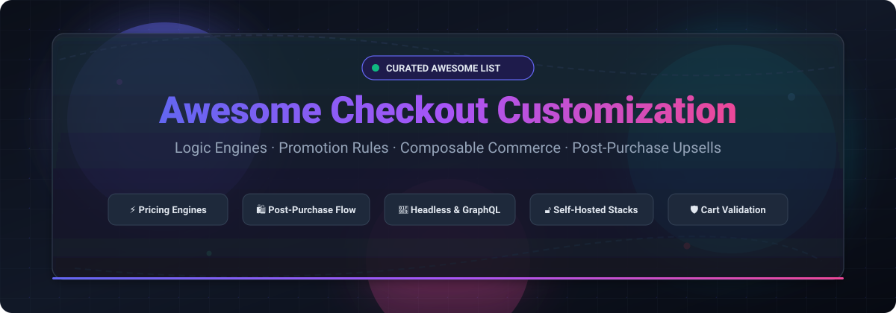

# 🛒 Awesome Checkout Customization ⚡

  <strong>A curated list of top SaaS platforms, open-source engines, composable checkout frameworks, and cart validation tools.</strong>

  
  
  
  
  
  
  

  <em>Discover, compare, and build next-generation checkout experiences: dynamic pricing rules, discount engines, post-purchase upsell funnels, headless checkout APIs, and cart validation logic.</em>

---

## 📑 Table of Contents

- [🔍 Sector Overview & Market Dynamics](#-sector-overview--market-dynamics)
- [☁️ SaaS & Hosted Platforms](#️-saas--hosted-platforms)
- [🔓 Open-Source GitHub Projects](#-open-source-github-projects)
- [🛠️ Architecture Recommendations](#️-architecture-recommendations)
- [🤝 How to Contribute](#-how-to-contribute)
- [💖 Support & Sponsorship](#-support--sponsorship)
- [📈 Star History](#-star-history)
- [⚠️ Disclaimer](#️-disclaimer)

---

## 🔍 Sector Overview & Market Dynamics

The global e-commerce checkout and shopping cart software market is valued at approximately **$10B to $13B** (with the broader e-commerce personalization, recommendation, and promotion engine layer adding another **$8B+**), expanding at an impressive CAGR of ~14%–19%. 

The sector operates with clear **two-tier market dynamics**:
1. **Core Platform Layer (Concentrated):** Dominated by major closed and hosted platforms (e.g., Shopify controlling SMB to mid-market hosted checkout, BigCommerce, Adobe Commerce).
2. **Customization & Logic Ecosystem (Moderately to Highly Fragmented):** Hundreds of specialized point solutions compete across niche categories—from rule-based pricing engines and post-purchase upsell funnels to headless API services and open-source composable commerce frameworks.

---

## ☁️ SaaS & Hosted Platforms

The following hosted solutions and apps provide no-code or low-code extensions for merchants. Entries are sorted descending by **Company Size (Revenue / Valuation)**:

| Platform / App | Company Size (Revenue / Valuation) | Pricing (Starting Tier) | Free Tier / Free Trial Limits | Description & Key Capabilities |
|---|---|---|---|---|
| **[Shopify Scripts & Script Editor](https://shopify.dev/docs/apps/checkout)** | ~$11.6B Revenue / ~$210B+ Market Cap | From **$2,300/mo** (included with Shopify Plus) | **No free tier or trial** (Requires active Shopify Plus subscription; Scripts stopped execution June 30, 2026, migrating to Shopify Functions) | Legacy Ruby-based checkout logic engine for Shopify Plus allowing line item, shipping, and payment customization. **Deprecated / Sunsetting June 30, 2026**; stores must migrate to WebAssembly Shopify Functions. |
| **[Bold Custom Pricing](https://www.boldcommerce.com/)** | ~$25M–$30M ARR / $44M VC Funded | From **$29/mo** (Essential plan; $69/mo Standard, $129/mo Complete) | **14-day free trial** (Full feature access to test wholesale/VIP tagging and quantity break discounts) | Customer-specific and quantity-based pricing app for Shopify. Uses customer tags to assign wholesale, VIP, or tiered group pricing without custom code. |
| **[Rebuy Engine](https://rebuyengine.com/)** | ~$12M–$19M ARR / $21.4M VC Funded | From **$25/mo** (Build Your Own / a la carte packages; Full suite from $534/mo) | **14-day free trial**; also offers **Rebuy Monetize free tier** (Free post-purchase offers earning transaction revenue, dev store access) | AI-powered personalization, Smart Cart, and upsell engine with Smart Links and checkout extensions to dynamically adjust cart line items. |
| **[Fast Simon](https://www.fastsimon.com/)** | ~$5M–$15M ARR (Private) | From **$39.99/mo** (Starter plan; Essential plan at $99.99/mo) | **Free tier available** (up to 100 monthly sessions, includes AI instant search & filters); **14-day free trial** on paid tiers | Search, merchandising, and product personalization SDK/app providing AI-driven search, recommendations, and cart-intent customization before checkout. |
| **[CartHook](https://carthook.com/)** | Processed $1B+ GMV (Acquired by Pantastic / Shop Circle) | **$0/mo base** on Pay As You Go ($0.12/order after free tier + 1% rev share) or **$49/mo** (Growth plan) | **Free tier: 20 orders/mo** on Pay As You Go plan ($0/mo base fee); **14-day free trial** on Growth ($49/mo) and Scale ($149/mo) plans | Post-purchase upsell and cross-sell platform with drag-and-drop funnel builder, checkout extensions, and one-click upsell acceptance. |
| **[Discount Ninja](https://apps.shopify.com/discount-url)** | ~$300K–$1M ARR (Ninja Commerce / Limoni Apps) | From **$49/mo** (Starter plan, up to 500 orders/mo; Pro $99/mo, Grow $199/mo) | **14-day free trial** (Includes full access to discount stacking, gifts, and promotion rules across all subscription plans) | Advanced promotion engine for Shopify with automated gifts, complex discount stacking, and dynamic promotion rule combinations. |
| **[Peak Dynamic Pricing](https://apps.shopify.com/peak-dynamic-pricing)** | Bootstrapped / Micro-SaaS (Pricing.AI) | From **$1.99/mo** (Basecamp plan; Summit $4.99/mo, Everest $11.99/mo) | **Free forever plan: Ground** (Free with 1 active pricing rule); **14-day free trial** on paid tiers | Rule-based and time-based price automation app for Shopify that schedules scheduled and demand-based price changes. |

---

## 🔓 Open-Source GitHub Projects

Explore open-source commerce platforms, checkout engines, promotion frameworks, and cart validation plugins. Entries are sorted descending by **GitHub Star Count**:

### 1. **[Medusa](https://github.com/medusajs/medusa)** 
- **License**: MIT (Core)
- **Tech Stack**: Node.js, TypeScript, PostgreSQL, Redis
- **Highlights**: Composable, headless commerce platform where checkout is fully yours to own and customize. Features isolated modules for cart, pricing, payment providers, and order fulfillment.
- **Checkout Control**: Full control via custom workflows, subscriber events, and custom storefront checkout flows.

### 2. **[Bagisto](https://github.com/bagisto/bagisto)** 
- **License**: MIT
- **Tech Stack**: PHP (Laravel), Vue.js, MySQL
- **Highlights**: A modular, customizable open-source eCommerce platform built on Laravel. Includes configurable one-page checkout, multi-currency support, cart rule discount engines, and catalog promotions out of the box.
- **Checkout Control**: Highly extensible checkout steps and customizable cart validation pipelines via Laravel service providers.

### 3. **[Saleor](https://github.com/saleor/saleor)** 
- **License**: BSD-3-Clause
- **Tech Stack**: Python (Django), GraphQL, PostgreSQL
- **Highlights**: GraphQL-first headless commerce platform with fine-grained checkout mutations (`checkoutCreate`, `checkoutLinesAdd`, `checkoutPaymentCreate`).
- **Checkout Control**: Apps with `HANDLE_CHECKOUTS` permissions can override line-item pricing on the fly, customize shipping methods dynamically via webhooks, and enforce tax calculations.

### 4. **[Spree Commerce](https://github.com/spree/spree)** 
- **License**: BSD-3-Clause / Dual
- **Tech Stack**: Ruby on Rails, Next.js (Storefront)
- **Highlights**: Battle-tested open-source platform offering a fully modular checkout state machine (Address -> Delivery -> Payment -> Confirm).
- **Checkout Control**: Built-in promotions engine supporting order-level rules, line-item adjustments, coupon codes, and store credit.

### 5. **[WooCommerce Core](https://github.com/woocommerce/woocommerce)** 
- **License**: GPL-3.0
- **Tech Stack**: PHP, WordPress, React (Gutenberg Checkout Blocks)
- **Highlights**: The world's most ubiquitous open-source eCommerce engine. Features a modern Block-based checkout allowing granular UI extension, conditional payment gateways, and custom checkout fields.
- **Checkout Control**: Virtually unlimited customization through WordPress hooks (`woocommerce_checkout_order_processed`, `woocommerce_cart_calculate_fees`), filter APIs, and custom discount plugins.

### 6. **[Sylius](https://github.com/Sylius/Sylius)** 
- **License**: MIT
- **Tech Stack**: PHP (Symfony), Doctrine, PostgreSQL/MySQL
- **Highlights**: Symfony-based headless commerce framework featuring the standalone `SyliusPromotionBundle`.
- **Checkout Control**: Decoupled rule checkers and actions allow developers to create sophisticated multi-tiered discount engines, cart validation rules, and custom checkout step resolvers.

### 7. **[Vendure](https://github.com/vendure-ecommerce/vendure)** 
- **License**: MIT
- **Tech Stack**: Node.js, TypeScript, GraphQL, PostgreSQL
- **Highlights**: Modern headless framework built on NestJS and GraphQL. Highly praised for developer ergonomics and clean plugin architectures.
- **Checkout Control**: Extensible via `@pinelab/vendure-plugin-validate-cart`, `CartValidatorStrategy`, custom promotion actions, and customizable payment processes.

### 8. **[Kill Bill](https://github.com/killbill/killbill)** 
- **License**: Apache-2.0
- **Tech Stack**: Java, OSGi, PostgreSQL/MySQL
- **Highlights**: Open-source subscription billing and payments platform. Ideal for handling complex checkout billing, payment routing, recurrent invoicing, and dunning workflows.
- **Checkout Control**: Integrates directly into checkout layers to orchestrate multi-gateway payment processing, recurring charge subscriptions, and coupon applications.

### 9. **[Solidus](https://github.com/solidusio/solidus)** 
- **License**: BSD-3-Clause
- **Tech Stack**: Ruby on Rails
- **Highlights**: Enterprise-grade fork of Spree Commerce dedicated to stability, customizability, and high-volume merchant scalability.
- **Checkout Control**: Configurable checkout flow state machine with native promotion calculators, tax adjusters, and custom shipping rate engines.

### 10. **[Open Incentives](https://github.com/squeakycheese75/open-incentives)** 
- **License**: Open Source
- **Tech Stack**: Go (Golang), Docker
- **Highlights**: A lightweight, self-hosted discount and promotion engine. Evaluates cart and customer attributes via `POST /v1/evaluate` to return qualifying campaigns and discounts.
- **Checkout Control**: Functions as an agile, standalone microservice providing coupon and discount calculation without the overhead of heavy enterprise incentive suites.

---

## 🛠️ Architecture Recommendations

- **Building Custom Checkout Stacks**: Integrate a standalone promotion engine like **Open Incentives** with composable backends like **Medusa**, **Saleor**, or **Vendure** to achieve complete control over pricing rules and cart state without vendor lock-in.
- **Shopify Environment Reminder**: Shopify checkout is a hosted, sandboxed environment. Open-source frameworks do not run directly inside Shopify checkout; Shopify customizations require native **Shopify Functions** (WebAssembly) and **Checkout UI Extensions**.

---

## 🤝 How to Contribute

Contributions are warmly welcomed! Help keep this directory comprehensive and up to date:

1. 🍴 Fork the repository.
2. 🌿 Create a feature branch (`git checkout -b feature/new-checkout-tool`).
3. 📝 Add your entry ensuring accurate pricing tiers, free trial specifics, license details, and proper star badges.
4. 🚀 Open a Pull Request with a clear description of the project.

---

## 💖 Support & Sponsorship

If this curated repository saved you research time or helped in your commerce architecture:

- 🌟 **Star the repository** to boost visibility on GitHub.
- 🍴 **Fork and share** with colleagues and commerce developer communities.
- ☕ **Buy a coffee or sponsor** future open-source tools: [**Sponsor Dashboard on GitHub**](https://github.com/sponsors/ishandutta2007)

Thank you for your generous support! 🙏

---

## 📈 Star History

---

## ⚠️ Disclaimer

- This curated list is maintained for informational and developer research purposes only; it does not constitute an official endorsement.
- All pricing, limits, and feature sets are verified as of October 2026 and are subject to change by respective vendor platforms.
- Applications modifying checkout, pricing calculation, or collecting card data must comply with **PCI DSS** standards and regional data protection regulations (GDPR, CCPA).
